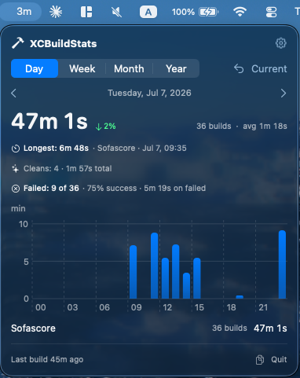
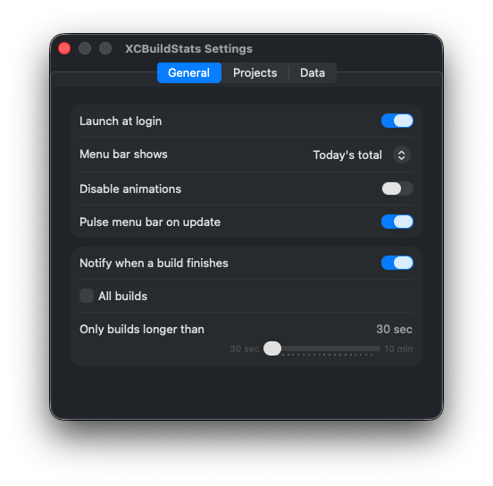

# XCBuildStats

A macOS menu bar app that tracks how much time you spend on local Xcode builds —
grouped by **day / week / month / year**, across **all** projects on your Mac.

<p align="center">
  
  
</p>

## Features

- ⏱️ **Build time** per day / week / month / year, with a per-hour/day/month bar chart.
- 🧭 **Navigate** periods with ‹ › and jump back with **Current**.
- 📊 **Per-project** breakdown, **longest build**, **clean** count, and **build success rate**.
- 🖱️ **Hover** any bar for its exact time.
- 🔔 **Menu bar** shows today's (or the selected period's) total at a glance.
- 📣 **Build notifications** (opt-in) — get an alert when a build finishes, for all
  builds or only ones longer than a threshold you pick (30 sec – 10 min).
- 🧰 **Quick tools** — one-click delete DerivedData, reset Swift Package caches,
  or force-quit Xcode, right from the dashboard (guarded while Xcode is running).
- 💾 **Own history** — keeps its data even after Xcode purges its logs.
- ⚙️ **Settings** — launch at login, menu-bar display, per-project filter, CSV export, and more.

Requires **macOS 14 (Sonoma) or later**.

## Install

1. Download the latest `XCBuildStats.dmg` from [Releases](../../releases).
2. Open it and drag **XCBuildStats** into Applications.
3. Launch it — the icon appears in the **menu bar** (no Dock icon).

The build is signed with a Developer ID and notarized, so it opens with no
Gatekeeper warnings. **Launch at login is enabled automatically** on first run
(toggle it off anytime in Settings).

## How it works

- **Source:** each project's `LogStoreManifest.plist` under
  `~/Library/Developer/Xcode/DerivedData/<Project>-<hash>/Logs/Build/`
  (no need to decompress the large `.xcactivitylog` files).
- **Own database:** Xcode keeps only the last few builds and wipes them when
  DerivedData is cleaned or regenerated. XCBuildStats copies each build into its
  own SQLite store (`~/.xcbuildstats/db.sqlite`, deduplicated by `uniqueIdentifier`),
  so your history grows over time independently of Xcode.
- **Collection:** on launch, on wake, at midnight, and live while the app is
  running (an FSEvents watch on DerivedData). There is no background daemon, so
  cleans and DerivedData wipes are only counted while the app is running.
- **Privacy:** everything stays on your Mac. The app has no network calls and no
  telemetry.
- **Known limitation:** Xcode's log store records a cancelled build with no
  cancellation marker, so a build you stop midway counts as a (short) successful
  build.

## Usage

- Click the menu-bar item to open the dashboard.
- Switch **Day / Week / Month / Year**; use **‹ ›** to move between periods and
  **Current** to jump back to now.
- Hover a bar to see its exact minutes.
- Quick tools at the bottom: delete DerivedData, reset SPM caches, force-quit
  Xcode — the cache tools ask you to quit Xcode first so its packages stay intact.
- **Settings (⚙︎):**
  - **General** — launch at login, what the menu bar shows (today / selected
    period), animations, and build-finished notifications (all builds, or only
    ones longer than a chosen duration).
  - **Projects** — include/exclude specific projects from the stats.
  - **Data** — app version, database path, reveal it in Finder, export to CSV,
    or clear the database.

## Build from source

```sh
swift run XCBuildStats            # run the menu bar app (dev)
swift run XCBuildStats --report   # print the analysis to the terminal (no GUI)
```

Or open `XCBuildStats.xcodeproj` in Xcode and Run. The project is generated with
[XcodeGen](https://github.com/yonaskolb/XcodeGen); after adding or removing source
files, regenerate it with `xcodegen generate`.

> `xcodebuild` and `swift test` need a full **Xcode** toolchain (for XCTest and app
> bundling), not just the Command Line Tools. If `xcode-select -p` points at
> `CommandLineTools`, prefix commands with `DEVELOPER_DIR=/Applications/Xcode.app/Contents/Developer`.

## Tests

```sh
swift test
```
Covers manifest parsing and clean-vs-build classification, day/week/month/year
aggregation and period boundaries (incl. midnight rollover), navigation limits,
SQLite round-trip / dedup / clear, the DerivedData-deletion diff (with safeguards
against false positives from transient reads), duration formatting, and CSV export.

## Roadmap

- [ ] Deep `.xcactivitylog` analysis: slowest files/targets, clean vs incremental builds
- [ ] Homebrew cask for one-command install
- [ ] More analytics: week/month deltas, time-of-day heatmap
